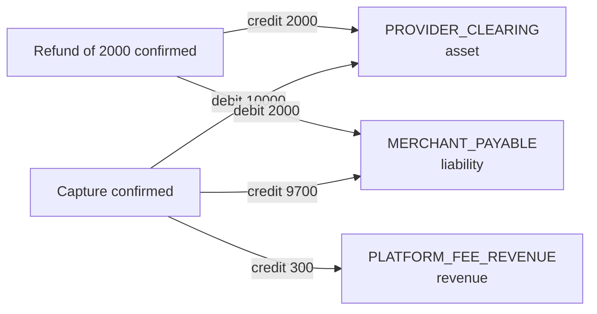
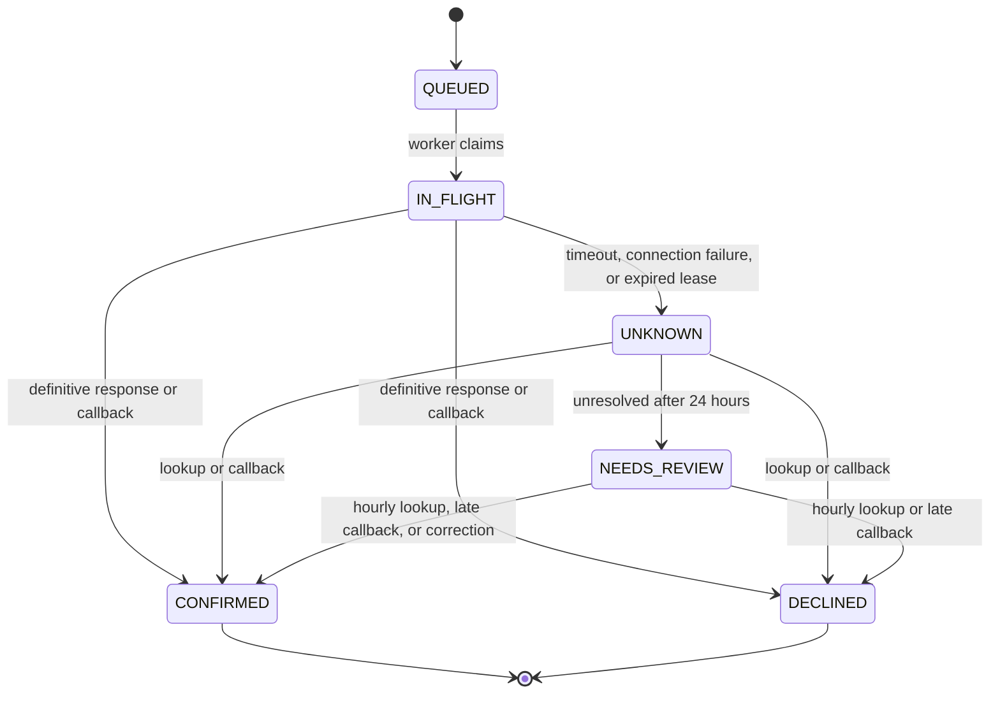
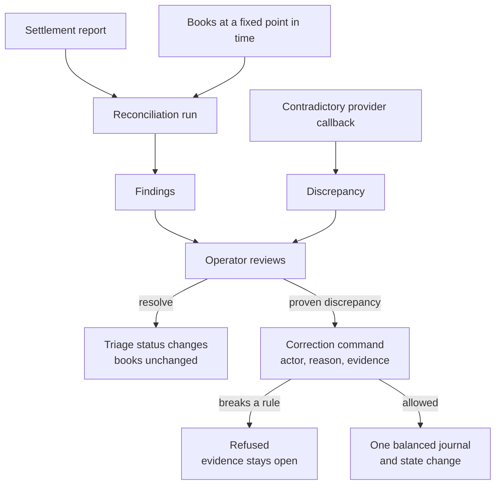

# Accounting scope and invariants

This is the contract the code must satisfy. So far only the posting function exists: it enforces invariants 1, 2, 4, and 5, and the at-most-once rule in invariant 3 ([tests](../src/test/java/io/github/aryodh/ledger/PostJournalIT.java)). Nothing calls it yet, and there is no API. Terms are defined in [GLOSSARY.md](../GLOSSARY.md).

## Scope

The ledger keeps the platform's books for one merchant, in SGD, using integer minor units (10000 is SGD 100.00).

| In v1 | Not in v1 |
| --- | --- |
| Immediate capture through one mock provider | Real card processing, authorization/capture split, PCI claims |
| Partial and full refunds | Chargebacks, disputes |
| A platform fee fixed at payment acceptance | Tax, provider fees, dynamic pricing |
| Transaction-level settlement reconciliation | Bank statements, merchant payouts, cash settlement postings |
| Recorded operator corrections | Public journal writes |
| One merchant, one currency | Multi-tenancy, foreign exchange |

Amounts are positive and capped at 100000000 minor units per operation. Fees satisfy `0 <= fee <= amount`.

## Accounts

| Account | Type | Normal side | Meaning |
| --- | --- | --- | --- |
| `PROVIDER_CLEARING` | Asset | Debit | Net amount expected from the provider |
| `MERCHANT_PAYABLE` | Liability | Credit | Amount owed to the merchant, before any payout |
| `PLATFORM_FEE_REVENUE` | Revenue | Credit | Fee earned on successful capture |

Balances are reported on the account's normal side, so a negative balance means the account moved past zero.

## Postings

Payment of 10000 with a fee of 300:

| Business event | Debit | Credit |
| --- | --- | --- |
| Capture confirmed | `PROVIDER_CLEARING` 10000 | `MERCHANT_PAYABLE` 9700, `PLATFORM_FEE_REVENUE` 300 |
| Refund of 2000 confirmed | `MERCHANT_PAYABLE` 2000 | `PROVIDER_CLEARING` 2000 |

Entries with a zero amount are omitted, so a capture with no fee has two entries.

Balances after each step of a full refund of that payment:

| After | `PROVIDER_CLEARING` | `MERCHANT_PAYABLE` | `PLATFORM_FEE_REVENUE` |
| --- | --- | --- | --- |
| Capture | 10000 | 9700 | 300 |
| Refund of 2000 | 8000 | 7700 | 300 |
| Refund of remaining 8000 | 0 | -300 | 300 |

The final -300 is a merchant deficit. Fees are not refunded, and the system does not hold the merchant to a nonnegative balance. See [ADR 0002](adr/0002-fees-not-refunded-no-payouts.md).

## Provider operation states

`CONFIRMED` posts the journal. `DECLINED` fails the payment or refund and releases any refund reservation. `UNKNOWN` and `NEEDS_REVIEW` change no money and keep the reservation.

## Invariants

1. Every journal has at least two entries, one currency, and equal total debits and credits.
2. Every entry has a positive integer amount and references an account in the journal's currency.
3. A business event posts at most one journal, however many times its transport event is delivered.
4. Application credentials cannot update or delete a committed journal or entry, or insert one except through the posting function.
5. Posting sequence numbers are unique, gapless, and in commit order.
6. For every payment, successful refunds plus reserved refunds never exceed the captured amount. The captured amount is the payment amount once the payment has succeeded, and zero otherwise.
7. A declined or unresolved provider operation cannot produce a success journal. The only exception is a correction.
8. A state change, its journal, its audit record, and its outbox event commit in one transaction.
9. Rebuilding balances from entries gives the same result as the balance API.
10. A refund reservation is released only on a definitive provider decline, never because the outcome is unknown.

## Guarantees

Each guarantee holds only once a test proves it. The README will link those tests as they exist.

- A client can retry a payment or refund request with the same idempotency key and get the original response, with no second operation.
- A provider timeout is treated as an unknown outcome, never as a decline.
- An accepted (`202`) request is durably committed.
- Reconciliation finds movements that differ between the books and the settlement report, including money the provider moved while the books say it did not.

## What this does not guarantee

- A matched settlement row does not mean cash reached a bank.
- Events can be delivered more than once and in any order. Sinks deduplicate by event ID.
- Immutability applies to application credentials. A database administrator can still change anything, so this is not tamper-proof storage.
- This is a reference implementation using synthetic data, and it is not financial or accounting advice.

## Who owns what

| Fact | Owner |
| --- | --- |
| Financial state and balances | The ledger database; journals and entries are the source of truth |
| Writing journals | The posting function only |
| Whether a provider operation happened | The provider; the ledger holds its best knowledge and records contradictions |
| Finding discrepancies | Reconciliation, which never changes balances |
| Changing financial state after a discrepancy | The correction command, with an actor, a reason, and evidence |
| Notifications | The outbox relay; a sink never decides whether money was posted |

## Corrections

A correction needs an open finding or recorded discrepancy as evidence. It posts one balanced journal, and rerunning it changes nothing.

| Discrepancy | Journal | State change |
| --- | --- | --- |
| Payment failed internally, provider captured | Capture postings | Payment `FAILED` to `SUCCEEDED` |
| Refund failed internally, provider refunded | Refund postings | Refund `FAILED` to `SUCCEEDED` |
| Capture succeeded internally, provider has no such movement | Reversal of the capture journal | Payment `SUCCEEDED` to `FAILED` |
| Refund succeeded internally, provider has no such movement | Reversal of the refund journal | Refund `SUCCEEDED` to `FAILED` |
| Operation in `NEEDS_REVIEW`, settlement report shows the movement | Capture or refund postings | Operation to `CONFIRMED`; payment or refund `PENDING` to `SUCCEEDED` |

The command refuses, and leaves the evidence open, in three cases:

- Correcting a failed refund would break invariant 6.
- Reversing a capture while the payment has a reserved or successful refund. Resolve those refunds first.
- Correcting a pending operation that isn't in `NEEDS_REVIEW`, or whose settlement row differs in amount or currency.

No correction moves an operation to `DECLINED`. A row missing from a settlement report doesn't prove the provider declined, so only a lookup or callback can do that. Until then the operation stays in `NEEDS_REVIEW` and any refund reservation stays held.

A reversal swaps the debits and credits of the original journal, which stays unchanged. See [ADR 0005](adr/0005-reconciliation-reports-corrections-post.md).
